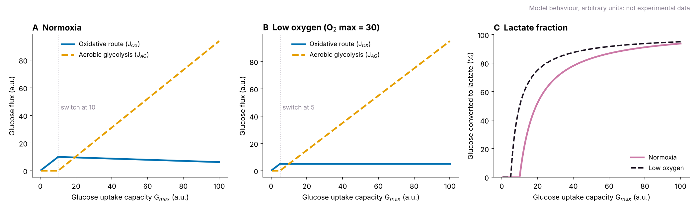
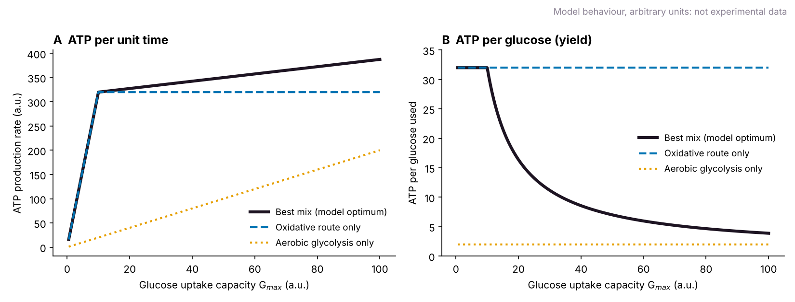
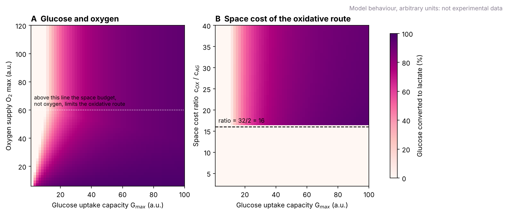
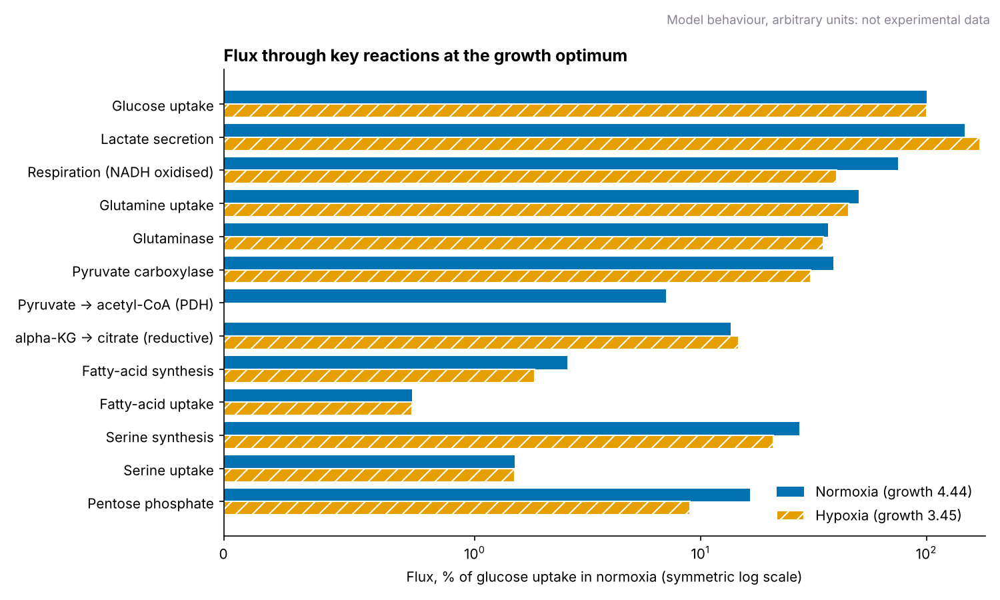
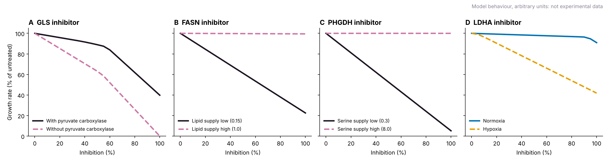
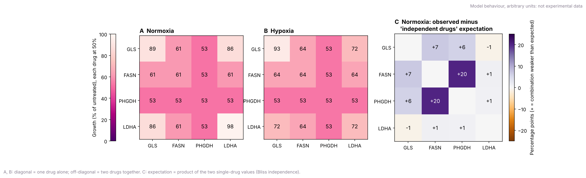
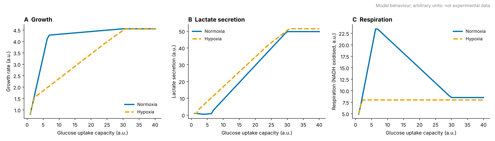

# Why Burn Glucose to Lactate? Flux-Balance Models of Cancer Cell Metabolism

> **Disclaimer.** This repository contains **simplified, illustrative models**. All parameter values are chosen to show qualitative behaviour; they are not measured or fitted to experimental data. The outputs are **not experimental results and not new scientific findings**. The purpose of the project is to make concepts from my published review literature concrete and explorable in code.

**Author:** Alper Öztürk

**Related paper:**

Öztürk, A. (2026). Metabolic Reprogramming in Cancer Cells: Investigating How Altered Glucose, Lipid, and Amino Acid Metabolism Supports Tumor Growth. *Next Frontier For Life Sciences and AI*, 10(1), 1–9. https://doi.org/10.62802/nflsai.94

**Live simulation:** https://officeofalper.github.io/cancer-flux-balance/web/ (network model, version 2) and https://officeofalper.github.io/cancer-flux-balance/web/simple.html (Warburg trade-off, version 1). No installation needed; see [Section 6](#6-interactive-versions).

**Companion project:** [tme-glucose-competition](https://github.com/officeofalper/tme-glucose-competition) models the *tumor microenvironment* (tumor cells vs T cells). This repository looks *inside one cancer cell*.

The repository contains two models of increasing detail:

| | Version 1: `warburg_tradeoff.py` | Version 2: `cancer_network.py` |
|---|---|---|
| Question | Why make lactate when oxygen is available? | How do glucose, glutamine, serine and lipid pathways support growth, and how does the network respond to drugs? |
| Nutrients | Glucose, oxygen | Glucose, glutamine, serine, fatty acids, other amino acids, oxygen |
| Size | 2 fluxes, 3 constraints | 40 reactions, 27 metabolites |
| Objective | Fastest ATP production | Fastest growth (biomass production) |
| Method | Linear programming (flux balance analysis) | Flux balance analysis + parsimonious tie-breaker |

---

## 1. Connection to my research

| What paper #94 says | How this repository uses it |
|---|---|
| Aerobic glycolysis (the Warburg effect) is inefficient in ATP yield but supports proliferation; most cancer cells keep functional mitochondria and oxidative phosphorylation (Sections 2.1, 5.1). | Version 1 asks when a cell that maximizes its ATP *rate* would make lactate while still respiring. Version 2 shows lactate secretion and respiration together. |
| Lactate export regenerates NAD⁺ for continued glycolysis (Section 5.1). | Version 2 separates cytosolic and mitochondrial NADH; cytosolic NADH must be recycled by LDHA (to lactate) or by a capacity-limited shuttle into mitochondria. |
| De novo lipogenesis (ACLY, ACC, FASN) supplies membrane lipid; some in vivo studies emphasize scavenging of exogenous lipids instead (Section 5.2). | FASN inhibition is tested at low and high lipid supply. |
| Glutaminolysis refills the TCA cycle (anaplerosis) and supplies nitrogen; serine/glycine feed one-carbon metabolism; de novo serine synthesis vs uptake varies with nutrient availability (Section 5.3). | Glutamine supplies carbon and nitrogen; PHGDH inhibition is tested at low and high serine supply. |
| Hypoxia favours glycolysis and reductive carboxylation of glutamine (Section 5.4). | Normoxia and hypoxia are compared. |
| Single-pathway targeting is often insufficient because of compensatory flux; combinations may be more effective (Sections 5.4, 5.5, 8). | Single drugs, backup routes and two-drug combinations are tested. |

**What comes from my paper and what does not.** The qualitative ideas above come from the literature I reviewed. Everything else is **my own modelling choice** and is not reported in my paper: the reaction list and its lumped stoichiometry, the "space budget" costs, the nutrient levels, the rule for how a drug acts, and all numbers in the results. The model structure of version 1 follows Vazquez et al. (2010), and the idea that the Warburg effect follows from maximizing growth under a space constraint follows Shlomi et al. (2011); both are cited in Section 8 but are not cited in my paper.

---

## 2. Version 1: the Warburg trade-off (`warburg_tradeoff.py`)

A cell can turn glucose into ATP in two ways:

- **Aerobic glycolysis (AG):** glucose → 2 lactate, about **2 ATP** per glucose.
- **Oxidative route (OX):** glucose + 6 O₂ → 6 CO₂, about **32 ATP** per glucose (textbook range ≈ 30–36).

The oxidative route gives far more ATP per glucose but needs many more enzymes and mitochondria per unit of flux. Space in the cell is limited (the "solvent capacity" of Vazquez et al., 2010), so both routes share one budget. The model finds the fluxes $J_{AG}$ and $J_{OX}$ that maximize the ATP production rate:

$$\max\; 2\,J_{AG} + 32\,J_{OX} \quad\text{subject to}\quad c_{AG} J_{AG} + c_{OX} J_{OX} \le 1,\quad J_{AG} + J_{OX} \le G_{max},\quad 6\,J_{OX} \le O_{2,max}$$

This is a tiny **flux balance analysis** (FBA) problem: a linear objective with linear constraints, solved by linear programming (`scipy.optimize.linprog`).

| Parameter | Value | Meaning |
|---|---|---|
| `atp_ag` / `atp_ox` | 2 / 32 | ATP per glucose for each route |
| `c_ag` / `c_ox` | 0.004 / 0.1 | share of the space budget used per unit flux |
| `g_max` | 1–100 | glucose uptake capacity (GLUT1/HK2 level) |
| `o2_max` | 1000 (no limit) or 30 (low oxygen) | oxygen supply |

### Results (model behaviour)



**The switch.** Below a glucose capacity of 10 the cell oxidizes all glucose. At 10 the mitochondria fill the space budget. Above 10, every extra glucose goes to lactate, and respiration even falls slightly, because space is moved from mitochondria to the cheaper glycolytic enzymes. At $G_{max}$ = 50, 83% of glucose becomes lactate. With low oxygen (O₂ max = 30), oxygen rather than space limits the mitochondria and the switch moves to 5.



**Rate vs yield.** At $G_{max}$ = 50 the mixed strategy makes ATP at a rate of 350, compared with 320 for the oxidative route alone and 100 for glycolysis alone, while its ATP *yield* falls from 32 to 7 per glucose. The cell "wastes" glucose to make ATP faster.



**When does lactate pay off?** (A) Lower oxygen moves the switch to lower glucose. (B) Aerobic glycolysis appears only when the oxidative route costs more than 16 times as much space per glucose as glycolysis (16 = 32 ÷ 2). Below that ratio, mitochondria make more ATP per unit of space and the model never makes lactate, however much glucose is available. In the model, the Warburg effect is therefore not caused by broken mitochondria, but by mitochondria being expensive in space.

---

## 3. Version 2: the network model (`cancer_network.py`)

### What is modelled

The cell is a **network of 40 lumped reactions** linking nutrients to building blocks:

- **Glucose:** hexokinase, glycolysis, oxidative pentose phosphate pathway (PPP) and ribose recycling, LDHA (lactate), the serine-synthesis branch (PHGDH–PSAT1–PSPH).
- **Mitochondria:** PDH, citrate synthase, oxidative and **reductive** isocitrate dehydrogenase, the rest of the TCA cycle (lumped), **pyruvate carboxylase (PC)**, respiration (NADH → ATP, uses O₂).
- **Glutamine and nitrogen:** glutaminase (GLS), glutamate dehydrogenase (both directions), transaminases (aspartate, alanine, branched-chain amino acids). Nitrogen is tracked through glutamine, glutamate, the other amino acids and NH₄⁺.
- **One-carbon:** SHMT (serine → glycine + one-carbon unit), glycine cleavage, one-carbon oxidation for NADPH.
- **Lipid:** ACLY and FASN (citrate → palmitate, using ATP and NADPH), or fatty-acid uptake.
- **Building blocks:** protein, nucleotides, lipid, NADPH and ATP combine into **biomass**; the biomass reaction rate is the growth rate.
- **Two NADH pools:** cytosolic NADH (from glycolysis) is recycled by LDHA or by a capacity-limited shuttle into mitochondria; mitochondrial NADH is oxidized by respiration.

FBA finds the reaction rates **v** that maximize growth subject to:

$$S\,v = 0 \;\;\text{(steady state)},\qquad lb \le v \le ub \;\;\text{(supply, drugs)},\qquad \textstyle\sum_i \text{cost}_i\, v_i \le 1 \;\;\text{(space budget, as in version 1)}$$

$S$ is the stoichiometric matrix (rows = metabolites, columns = reactions); see Orth et al. (2010) for an introduction to FBA. Many flux patterns can give the same maximal growth, so a second step picks the one with the **smallest total flux** (parsimonious FBA, Lewis et al., 2010).

**Drugs.** A drug at *x*% inhibition caps its enzyme at (1 − *x*) times the rate that enzyme carried in the untreated cell under the same conditions. Drugs: GLS inhibitor (e.g. CB-839), FASN inhibitor (e.g. TVB-2640), PHGDH inhibitor, LDHA inhibitor.

| Parameter | Default | Meaning |
|---|---|---|
| `glc_max` | 20 | glucose uptake capacity |
| `gln_max` / `bcaa_max` | 10 / 5 | glutamine / other amino acids (nitrogen donors) available |
| `ser_max` / `fa_max` | 0.3 / 0.15 | serine / fatty acids available from outside (low) |
| `o2_max` | 40 (normoxia), 4 (hypoxia) | oxygen supply |
| `shuttle_max` | 5 | NADH shuttle capacity into mitochondria |
| `atp_maint` | 5 | ATP for maintenance |

All reactions, stoichiometries and space costs are listed and commented in `REACTIONS` in `cancer_network.py`.

### Results (model behaviour)



**Normoxia vs hypoxia.** In normoxia the model cell sends 74% of glucose carbon to lactate *while respiring* (Warburg effect with working mitochondria), uses glutamine and pyruvate carboxylase to refill the TCA cycle, makes most serine itself, and fills its space budget. In hypoxia (O₂ = 4), growth falls to 78%, 87% of glucose carbon goes to lactate, PDH stops completely, and **all** citrate for lipid synthesis comes from glutamine by reductive carboxylation.



| Panel | Observation (model) | Related experimental finding |
|---|---|---|
| A: GLS inhibitor | At 50% inhibition growth is 89% of untreated; pyruvate carboxylase flux nearly doubles (7.8 → 14.1) to refill the TCA cycle from glucose. Without PC, the same dose leaves 63%, and full inhibition stops growth (0% vs 40% with PC). | Cheng et al. (2011): silencing GLS suppressed but did not eliminate glioblastoma cell growth, and PC-dependent, glucose-derived anaplerosis let cells become glutamine-independent. |
| B: FASN inhibitor | With low lipid supply, full inhibition leaves 23% growth; with high lipid supply (1.0), 99%. | Paper #94 (Section 5.2) notes conflicting results on lipogenesis dependence vs lipid scavenging. |
| C: PHGDH inhibitor | With low serine, full inhibition leaves 5%; with high serine (8.0), 100%. | Paper #94 (Section 5.3): de novo serine synthesis vs uptake varies with nutrient availability. |
| D: LDHA inhibitor | Normoxia: full inhibition still leaves 91% (pyruvate and NADH are rerouted into mitochondria). Hypoxia: 42%. | Paper #94 (Section 5.1): glycolytic inhibitors alone have shown limited clinical success, consistent with compensatory mitochondrial activity. |



**Two drugs together.** In this model, combinations rarely beat the stronger single drug. For example, PHGDH + FASN (each 50%) gives 53%, exactly the PHGDH value. Panel C compares each combination with the "independent drugs" (Bliss) expectation, the product of the two single-drug values: most combinations are *weaker* than expected (up to +20 percentage points). The reason is built into FBA: growth is set by the tightest bottleneck, so adding a second, looser bottleneck changes nothing. A combination would help most when the second drug blocks the backup route of the first; none of the four drug pairs does this clearly here (GLS + LDHA, 86%, is close to the independent-drugs expectation of 87%). This **does not test** the suggestion in my paper that combinations may be more effective: real drugs also kill cells, act through regulation and have different toxicities, none of which FBA contains.



**More glucose, more lactate.** As in version 1, raising glucose uptake above about 7 turns extra glucose into lactate while respiration falls (from 23 to 8.5) as space moves from mitochondria to glycolysis. With very high glucose (≥ 30) the hypoxic cell grows as fast as the normoxic one, because glycolysis alone can then fill the space budget.

---

## 4. Limitations

- **Toy network.** 40 lumped reactions instead of the thousands in genome-scale human models (Shlomi et al., 2011, used one). Stoichiometries are rounded and simplified (for example, the TCA steps after α-ketoglutarate are one reaction).
- **No regulation, kinetics or thermodynamics.** FBA shows which flux patterns the network *allows* and which one maximizes growth. It cannot show how a cell switches (HIF-1α, c-Myc, mTORC1, SREBP1) or how fast. "Compensation" here means "an alternative route exists and has capacity", not that the cell up-regulates it.
- **Reductive carboxylation is over-used in normoxia.** The model makes about two thirds of citrate reductively even in normoxia. Metallo et al. (2012) found this pathway active in most cell lines under normal culture conditions, but cells preferentially used glucose carbon for palmitate in normoxia and switched to about 80% glutamine-derived carbon only under hypoxia. Without thermodynamic constraints the model cannot reproduce this preference.
- **Space costs are my choice.** The costs were tuned by hand so that the space budget, not a nutrient, limits growth in normoxia. As a check, I halved or doubled the costs of the pentose phosphate pathway, malic enzyme and reductive carboxylation (27 combinations): the normoxic lactate fraction stayed between 72% and 78% and every drug result in Figure 5 changed by at most 0.05, but the share of citrate made reductively in normoxia ranged from 47% to 90%. Larger changes to the network itself (for example, letting cytosolic NADH enter mitochondria freely) changed the results substantially during development.
- **Growth only.** No cell death, no immune cells, no tumor microenvironment (see the companion project), no drug toxicity to normal cells.
- **Arbitrary units.** Nutrient levels, doses and growth rates have no real-world meaning.

---

## 5. Files

```
warburg_tradeoff.py   version 1: Warburg trade-off, figures 1-3
cancer_network.py     version 2: network model, figures 4-7
figures/              all figures produced by the scripts
web/index.html        interactive network model (version 2)
web/simple.html       interactive Warburg trade-off (version 1)
requirements.txt      numpy, scipy, matplotlib
```

## 6. Interactive versions

The `web/` folder contains browser versions of both models; they need no installation and work offline (fonts excepted).

- **simple.html (version 1):** a cell with a glucose arrow that splits into aerobic glycolysis and the mitochondrion; arrow widths and mitochondrion size follow the fluxes, and a bar shows how the space budget is shared. Sliders: glucose capacity, oxygen, space cost of mitochondria, ATP yield of the oxidative route. The page solves the two-variable linear program exactly.
- **index.html (version 2):** a metabolic map whose arrow widths follow the reaction rates (grey dashed = route not used; teal bar = drug-inhibited enzyme), with sliders for nutrients, oxygen and four drugs, switches for the two backup routes (pyruvate carboxylase, reductive carboxylation), live dose–response curves and a bar chart of key fluxes compared with the untreated cell. A short text explains which backup route took over. The page contains its own linear-programming solver (two-phase simplex); on 120 random parameter sets it reproduced the Python growth rates to within 10⁻⁶.

**Colors.** Line colors in the Python figures come from the Okabe–Ito color-blind-safe palette, and lines that must be told apart also differ in line style (solid, dashed, dotted). In the web pages, every dose–response curve has its own line style as well as color.

To publish with GitHub Pages: *Settings → Pages → Deploy from branch*, then open `https://<your-username>.github.io/<repo-name>/web/`.

## 7. How to run the Python models

Requires Python 3 with `numpy`, `scipy` and `matplotlib`.

```bash
pip install -r requirements.txt
python warburg_tradeoff.py   # version 1, about 10 seconds
python cancer_network.py     # version 2, about 3 seconds
```

Each script prints a summary and saves its figures in `figures/`. To try your own scenario, change `DEFAULT_PARAMS`, or call `solve({...})` with your own parameters, e.g. `solve({"o2_max": 4, "inh_GLS": 0.5})`.

---

## 8. References cited above

These references are not cited in my paper #94; they are the sources for the modelling approach and for the experimental comparisons in Section 3.

- Cheng, T., Sudderth, J., Yang, C., Mullen, A. R., Jin, E. S., Matés, J. M., & DeBerardinis, R. J. (2011). Pyruvate carboxylase is required for glutamine-independent growth of tumor cells. *Proceedings of the National Academy of Sciences USA*, 108(21), 8674–8679. https://doi.org/10.1073/pnas.1016627108
- Lewis, N. E., Hixson, K. K., Conrad, T. M., Lerman, J. A., Charusanti, P., Polpitiya, A. D., Adkins, J. N., Schramm, G., Purvine, S. O., Lopez-Ferrer, D., Weitz, K. K., Eils, R., König, R., Smith, R. D., & Palsson, B. Ø. (2010). Omic data from evolved *E. coli* are consistent with computed optimal growth from genome-scale models. *Molecular Systems Biology*, 6, 390. https://doi.org/10.1038/msb.2010.47
- Metallo, C. M., Gameiro, P. A., Bell, E. L., Mattaini, K. R., Yang, J., Hiller, K., Jewell, C. M., et al. (2012). Reductive glutamine metabolism by IDH1 mediates lipogenesis under hypoxia. *Nature*, 481(7381), 380–384. https://doi.org/10.1038/nature10602
- Orth, J. D., Thiele, I., & Palsson, B. Ø. (2010). What is flux balance analysis? *Nature Biotechnology*, 28(3), 245–248. https://doi.org/10.1038/nbt.1614
- Shlomi, T., Benyamini, T., Gottlieb, E., Sharan, R., & Ruppin, E. (2011). Genome-scale metabolic modeling elucidates the role of proliferative adaptation in causing the Warburg effect. *PLoS Computational Biology*, 7(3), e1002018. https://doi.org/10.1371/journal.pcbi.1002018
- Vazquez, A., Liu, J., Zhou, Y., & Oltvai, Z. N. (2010). Catabolic efficiency of aerobic glycolysis: The Warburg effect revisited. *BMC Systems Biology*, 4, 58. https://doi.org/10.1186/1752-0509-4-58
